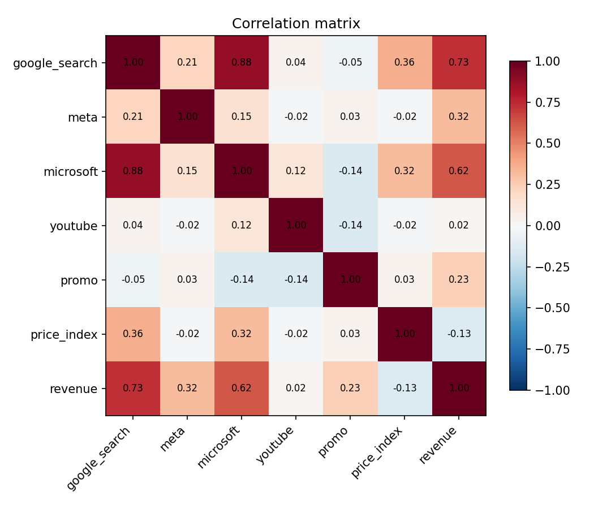
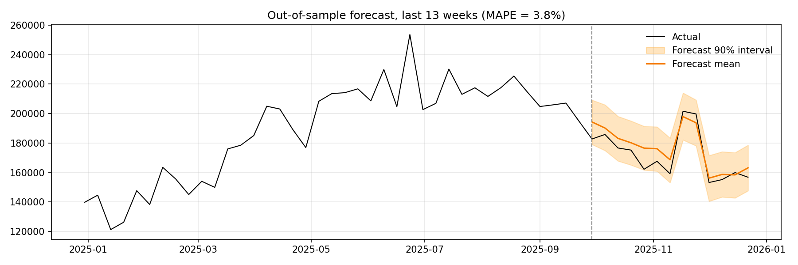
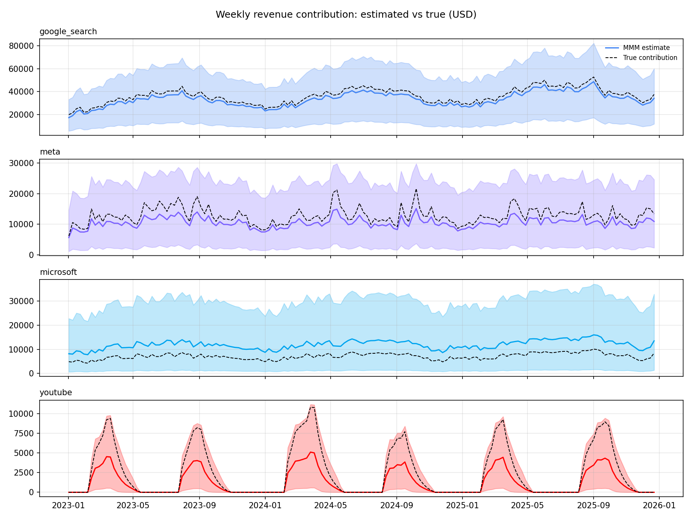
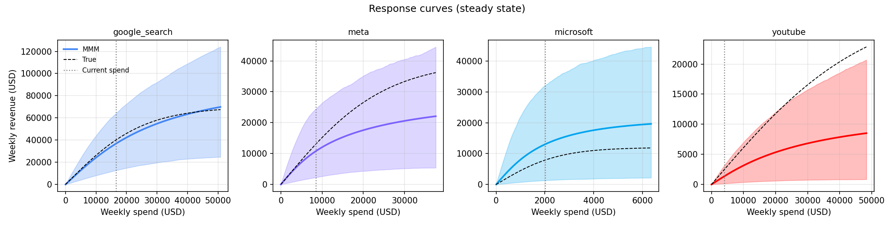
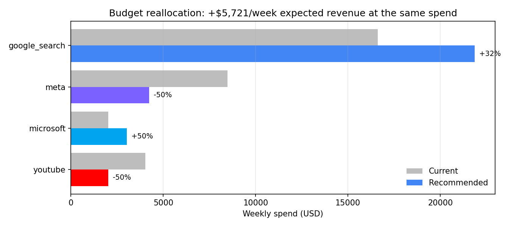
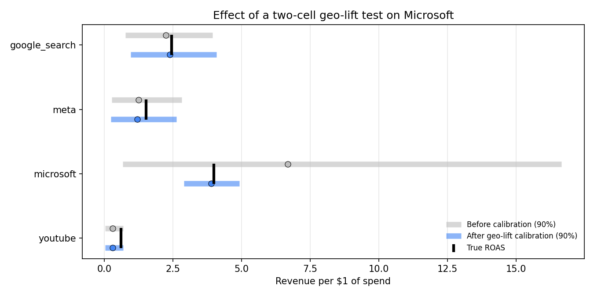

# Findings: Marketing Mix Model

This is the detailed write-up for the [Marketing Mix Model](README.md). It covers what the model found, how far each finding can be trusted, and what to do next.

The data is simulated, so every number here can be checked against the **true** values used to generate it (`data/ground_truth/`). The model never reads those files; they are used only for this validation.

---

## Summary

1. **Simple regression gives the wrong answer.** It says Microsoft Ads *loses* money (ROAS −6.06) and YouTube does nothing (0.02). Both channels are profitable or contributing in reality.
2. **The Bayesian MMM recovers the true ROAS of all four channels** within its 90% intervals, and forecasts 13 unseen weeks with 3.8% MAPE.
3. **Same budget, better mix:** moving spend toward Google Search and Microsoft and away from Meta and YouTube gains **+$3.0k revenue per week (~$157k per year)** against the ground truth. That is 97% of the best gain possible.
4. **The model overstates the size of that gain** (+$5.7k expected vs +$3.0k true). It is most wrong about the channels it is least certain about.
5. **One geo-lift experiment fixed Microsoft's estimate.** Its ROAS moved from 6.68 to 3.89 (true: 3.99) and the interval narrowed 8x.
6. **Meta and YouTube are still undervalued.** The next experiment should test one of them.

---

## Finding 1: Naive regression is misleading

Regressing weekly revenue on weekly spend, a common first step, gives this:

| Channel | True ROAS | Naive regression | Bayesian MMM (90% interval) |
|---|---|---|---|
| Google Search | 2.45 | 6.64 | 2.25 (0.77–3.95) |
| Meta | 1.52 | 1.69 | 1.25 (0.27–2.83) |
| Microsoft | 3.99 | **−6.06** | 6.68 (0.67–16.65) |
| YouTube | 0.61 | **0.02** | 0.31 (0.04–0.69) |

The naive model overcredits Google by 2.7x, says Microsoft destroys revenue, and says YouTube has no effect. Each error has a cause that also appears in real accounts:

| Problem | What happens in the data | Effect on naive regression |
|---|---|---|
| **Confounding** | Google spend rises with seasonal demand | Google gets credit for demand it didn't create |
| **Collinearity** | Microsoft copies Google's campaigns (correlation 0.88, VIF 4.7) | The model can't split credit, so Microsoft goes negative |
| **Carryover** | YouTube runs in bursts, and its effect lasts weeks (true adstock 0.70) | Same-week correlation with revenue is 0.02, so YouTube looks useless |

**So what:** a team acting on the naive model would cut Microsoft, its highest-ROAS channel, and pour more into Google.

---

## Finding 2: The MMM recovers the truth, within its uncertainty

### Model health

| Check | Result |
|---|---|
| Divergences | 0 |
| Max r̂ | 1.011 |
| Minimum ESS | 743 |
| In-sample R² / MAPE | 0.92 / 3.6% |
| Holdout MAPE (last 13 weeks, refit on first 143) | **3.8%**, all 13 actuals inside the 90% interval |

### Non-media effects

| Component | Model | True |
|---|---|---|
| Media share of revenue | 30.7% | 31.6% |
| 10% price increase | about −$31k per week | −$30k per week |
| Promo weeks | about +$36k per week | +$35k per week |

### Carryover (adstock)

| Channel | True | Estimated (90% interval) |
|---|---|---|
| Google Search | 0.20 | 0.25 (0.03–0.51) |
| Meta | 0.45 | 0.43 (0.14–0.74) |
| Microsoft | 0.20 | 0.25 (0.02–0.57) |
| YouTube | 0.70 | 0.61 (0.26–0.90) |

### Total contribution over 156 weeks

| Channel | Model | True | Error |
|---|---|---|---|
| Google Search | $5.18M | $5.64M | −8% |
| Meta | $1.64M | $2.00M | −18% |
| Microsoft | $1.86M | $1.11M | **+67%** |
| YouTube | $0.19M | $0.38M | **−50%** |

**So what:** every true ROAS falls inside the model's 90% interval, but the point estimates are not equally reliable. Google is close. Microsoft is overcredited because it is small and tracks Google closely. YouTube is undercredited by half. These errors carry through to the budget recommendation (Finding 4).

### Priors mattered

A first version gave every channel the same short-carryover prior. It estimated YouTube's carryover at 0.24 (true: 0.70) and understated its contribution. The final model uses two priors based on domain knowledge:

- **Effect size scaled by share of spend**, which helps separate Google from Microsoft.
- **Carryover by channel type:** short for search, medium for social, long for video.

---

## Finding 3: Same budget, better mix

Average ROAS answers "how did this channel do?". Marginal ROAS answers "where should the next dollar go?". At current spend:

| Channel | Weekly spend | Avg ROAS | Marginal ROAS (90% interval) | True marginal |
|---|---|---|---|---|
| Google Search | $16.6k | 2.22 | 1.70 (0.54–2.93) | 1.84 |
| Meta | $8.5k | 1.27 | 0.89 (0.23–1.73) | 1.43 |
| Microsoft | $2.0k | 6.48 | 3.65 (0.33–8.71) | 2.66 |
| YouTube | $4.0k | 0.34 | 0.33 (0.04–0.74) | 0.62 |

The optimiser keeps the $31.1k weekly total fixed and limits each channel to 50–150% of its current spend:

| Channel | Current | Recommended | Change | True optimum |
|---|---|---|---|---|
| Google Search | $16,620 | $21,869 | **+$5,249 (+32%)** | $20,571 |
| Meta | $8,486 | $4,243 | **−$4,243 (−50%)** | $5,590 |
| Microsoft | $2,011 | $3,016 | **+$1,005 (+50%)** | $2,967 |
| YouTube | $4,024 | $2,012 | **−$2,012 (−50%)** | $2,012 |

| | Per week | Per year |
|---|---|---|
| Model expected uplift | +$5.7k (90% interval −$1.2k to +$13.0k) | ~$298k |
| Probability the new plan beats the current one | 92% | |
| **True uplift (ground truth)** | **+$3.0k** | **~$157k** |
| Best possible uplift (true optimum) | +$3.1k | ~$161k |

**So what:** the recommendation points in the right direction for every channel and captures 97% of the best achievable gain. The biggest difference from the true optimum is Meta: the model cuts it to $4.2k, but the true optimum keeps $5.6k.

---

## Finding 4: The model overstates its own gain

The model expects +$5.7k per week; the true gain is +$3.0k. The optimiser leans hardest on the estimates it is least sure of:

- **Microsoft** is overcredited (+67% contribution error), so the model expects more from adding to it than it delivers.
- **Meta and YouTube** are undercredited, so the model underestimates what cutting them costs.
- **Three of four channels hit the ±50% guardrail.** Without guardrails, the optimiser would move even more budget based on those errors.

**So what:** treat the *direction* of an MMM recommendation as more reliable than its *size*. Keep guardrails, roll changes out in stages, and check results against an experiment.

---

## Finding 5: One geo-lift test fixed Microsoft

A simulated two-cell geo test on Microsoft over 8 weeks:

| Cell | Design | Measured lift per week | Model predicted (before calibration) |
|---|---|---|---|
| Go dark | Microsoft off in test regions | −$7.9k (±$1.2k) | −$13.0k (−$32.1k to −$1.3k) |
| Double | Microsoft spend doubled in test regions | +$3.3k (±$0.5k) | +$4.6k (+$0.3k to +$12.2k) |

Both cells were needed. The "double" cell only measures the value of the *next* dollars (incremental ROAS 1.62). The "go dark" cell measures the value of the spend already running (incremental ROAS 3.93), which is what pins down overall ROAS.

Adding the results as a likelihood term (0 divergences after calibration):

| Channel | True ROAS | Before (90% width) | After (90% width) |
|---|---|---|---|
| Microsoft | 3.99 | 6.68 (16.0) | **3.89 (2.0)** |
| Google Search | 2.45 | 2.25 (3.18) | **2.39** (3.14) |
| Meta | 1.52 | 1.25 (2.56) | 1.20 (2.39) |
| YouTube | 0.61 | 0.31 (0.65) | 0.31 (0.65) |

**So what:** Google also improved, even though it wasn't tested, because the experiment settled how search credit splits between Google and Microsoft. But the recommended allocation didn't change, and the expected uplift only dropped from $5.7k to $5.6k (true: $3.0k). The remaining error comes from Meta and YouTube, which weren't tested.

---

## Recommendations

| # | Action | Why |
|---|---|---|
| 1 | **Shift budget toward Google Search and Microsoft**, within ±50% guardrails | Right direction for every channel; ~$157k per year true gain |
| 2 | **Roll out in stages**, starting with the Google and Microsoft increases | The model overstates the gain, so confirm with real results before going further |
| 3 | **Cut Meta less than the model says** until it is tested | The model undervalues Meta; the true optimum keeps ~$5.6k per week |
| 4 | **Run the next geo test on Meta or YouTube** | Those two are now the main source of error |
| 5 | **For YouTube, cut bursts rather than spreading spend thinner** | Its effect comes from carryover after bursts |
| 6 | **Refit the model after each experiment** and re-run the optimiser | Calibration is cumulative; each test makes the next recommendation more reliable |

---

## Limitations

- **Simulated data:** real data is never this clean, and real MMMs can't be checked against ground truth.
- **Steady-state optimisation:** the optimiser assumes constant weekly spend, but YouTube runs in bursts.
- **Not modelled:** competitor activity, macro factors and channel interactions (for example, YouTube lifting branded search).
- **The ±50% guardrails** are a business judgement, not a model output.
- **The geo test is simulated**, with clean regions and no spillover between test and control.
