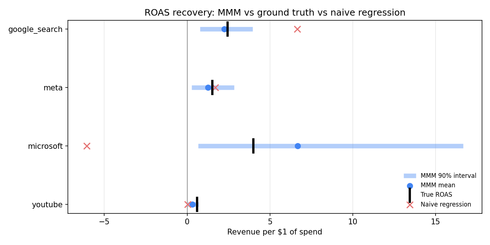

# Marketing Mix Model: what actually drove revenue?

A Bayesian Marketing Mix Model (MMM) built with [PyMC-Marketing](https://www.pymc-marketing.io/) that measures the **incremental** revenue from Google Search, Meta, Microsoft Ads and YouTube. It is calibrated with a geo-lift experiment and turned into a budget recommendation.

The data is simulated, so the **true** effect of every channel is known. That makes it possible to check how close the model gets, which real-world MMMs can never do.

> **Part 3 of a marketing analytics series**
> 1. [Multi-channel attribution & ROAS](https://github.com/paolofelix/multichannel-attribution-roas): which channel gets credit?
> 2. [Cohort LTV & CAC payback](https://github.com/paolofelix/cohort-ltv-cac-payback): what is a customer worth, and how fast does spend pay back?
> 3. **Marketing Mix Model**: what would have happened *without* each channel?
> 4. [Lead Scoring Model](https://github.com/paolofelix/lead-scoring-model): which leads will actually close, and which should sales call first?

**Full results, tables and recommendations: [FINDINGS.md](FINDINGS.md)**

---

## Key results

| | |
|---|---|
| **Recommendation** | Same $31.1k weekly budget: Google **+32%**, Microsoft **+50%**, Meta **−50%**, YouTube **−50%** |
| **Expected uplift** | +$5.7k revenue per week; 92% probability it beats the current plan |
| **True uplift (ground truth)** | **+$3.0k per week (~$157k per year)**, which is 97% of the best achievable (+$3.1k) |
| **ROAS recovery** | True ROAS falls inside the model's 90% interval for all 4 channels |
| **Forecast accuracy** | 3.8% MAPE on 13 held-out weeks; all actuals inside the 90% interval |
| **Calibration** | One geo-lift test narrowed Microsoft's ROAS interval **8x** (16.0 → 2.0) and moved its estimate from 6.68 to 3.89 (true: 3.99) |



---

## Why this matters

Regressing revenue on spend, the approach many teams start with, says Microsoft Ads **loses** money (ROAS −6.06) and YouTube does nothing (0.02). Both are wrong, and both would lead to bad budget decisions. The data contains the three problems that cause this in real accounts:

- **Confounding:** Google spend rises with seasonal demand.
- **Collinearity:** Microsoft copies Google's campaigns (spend correlation 0.88).
- **Carryover:** YouTube's effect lasts weeks after each burst.

The MMM handles all three and recovers each channel's true ROAS within its uncertainty interval.

## What I learned

- **Trust the direction more than the size.** The plan was right for every channel, but the model expected almost twice the true gain, because the optimiser leaned on its most uncertain estimates.
- **Experiments fix what models can't.** One two-cell geo test corrected Microsoft and improved Google too, since it settled how search credit splits between them.
- **Priors are domain knowledge.** Giving video a longer carryover prior than search fixed a badly underestimated YouTube effect.

See [FINDINGS.md](FINDINGS.md) for the evidence behind each point, the full validation tables and the recommended next steps.

---

## Approach

| Step | What | Notebook |
|---|---|---|
| 1. Simulate | 156 weeks of spend and revenue with known adstock, saturation, seasonality, promos and a 10% price increase | `01_simulate_data.ipynb` |
| 2. Explore | Spend mix, correlation, VIF, naive regression | `02_eda.ipynb` |
| 3. Model | Bayesian MMM: geometric adstock → logistic saturation, controls, yearly Fourier seasonality | `03_model.ipynb` |
| 4. Validate | Ground-truth recovery and a 13-week out-of-sample forecast | `03_model.ipynb` |
| 5. Optimise | Response curves, marginal ROAS, constrained budget optimiser | `03_model.ipynb` |
| 6. Calibrate | Two-cell geo-lift test on Microsoft, added as a likelihood term | `03_model.ipynb` |

**Model diagnostics:** 0 divergences, max r̂ 1.011, minimum ESS 743, in-sample R² 0.92.

---

## How to run

All notebooks run in Google Colab and read the data directly from this repo.

```bash
pip install -r requirements.txt
```

Run the notebooks in order: `01` → `02` → `03`. Steps 3–6 run in one session in `03_model.ipynb`; the model fit takes about 1–3 minutes with the nutpie sampler.

`data/ground_truth/` is used **only** for validation. The model never reads it.

## Repository structure

```
├── FINDINGS.md                   # full results, tables and recommendations
├── data/
│   ├── mmm_data.csv              # model input
│   └── ground_truth/             # true contributions & parameters (validation only)
├── notebooks/
│   ├── 01_simulate_data.ipynb
│   ├── 02_eda.ipynb
│   └── 03_model.ipynb            # model, validation, optimisation, calibration
├── outputs/figures/              # all charts used in README and FINDINGS
├── src/simulate_data.py
└── requirements.txt
```

**Tech:** Python · PyMC-Marketing · PyMC · nutpie · ArviZ · pandas · NumPy · SciPy · Matplotlib
