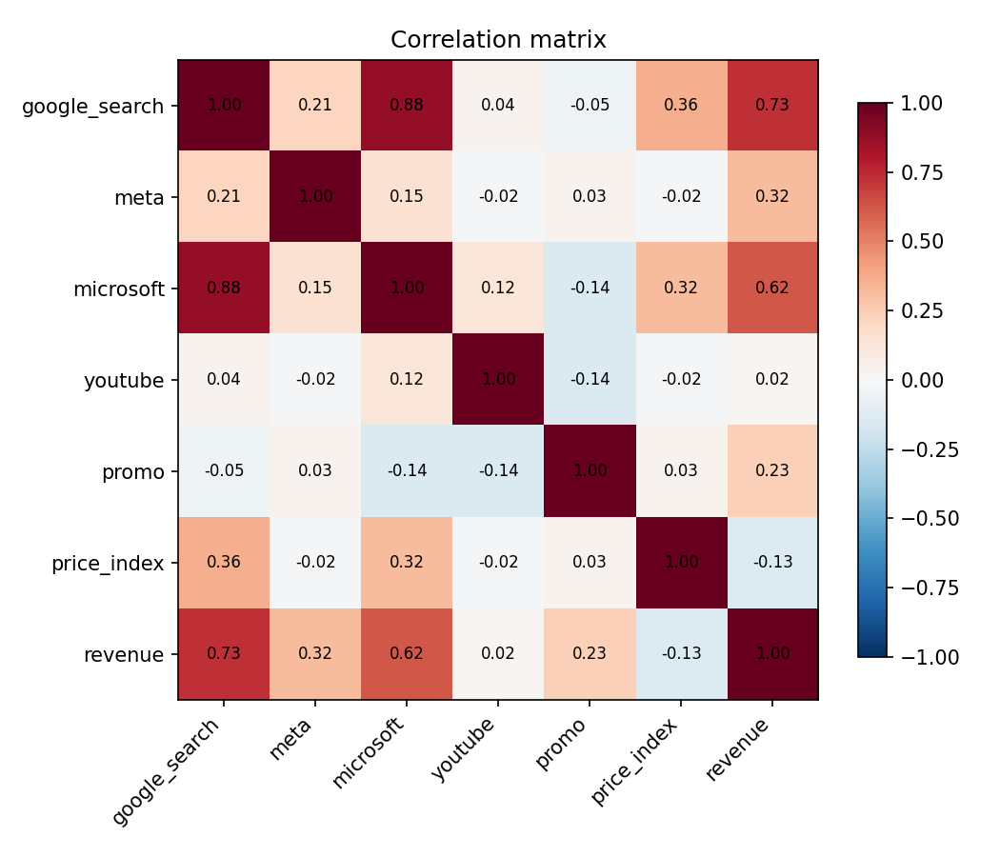
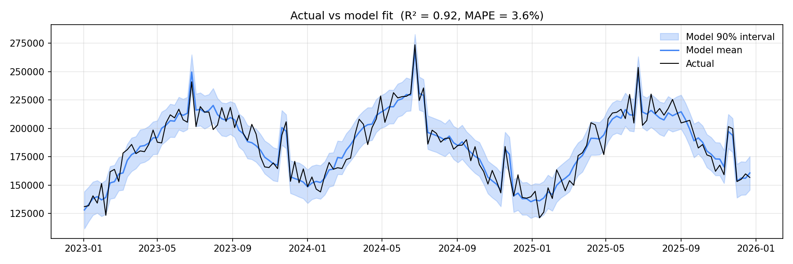
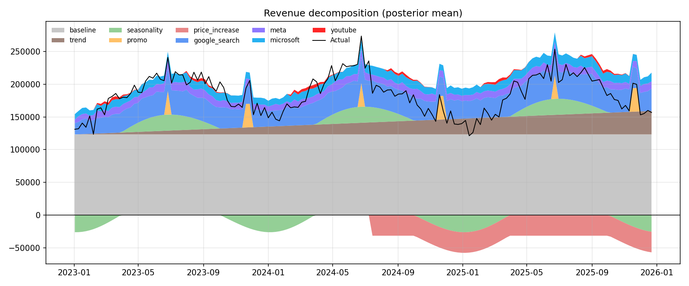
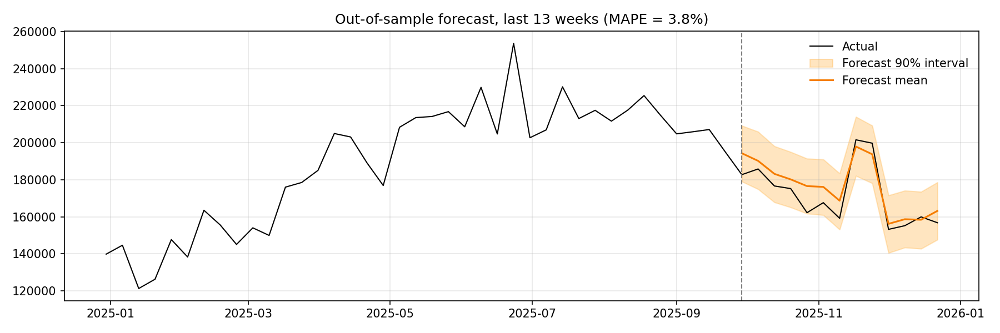
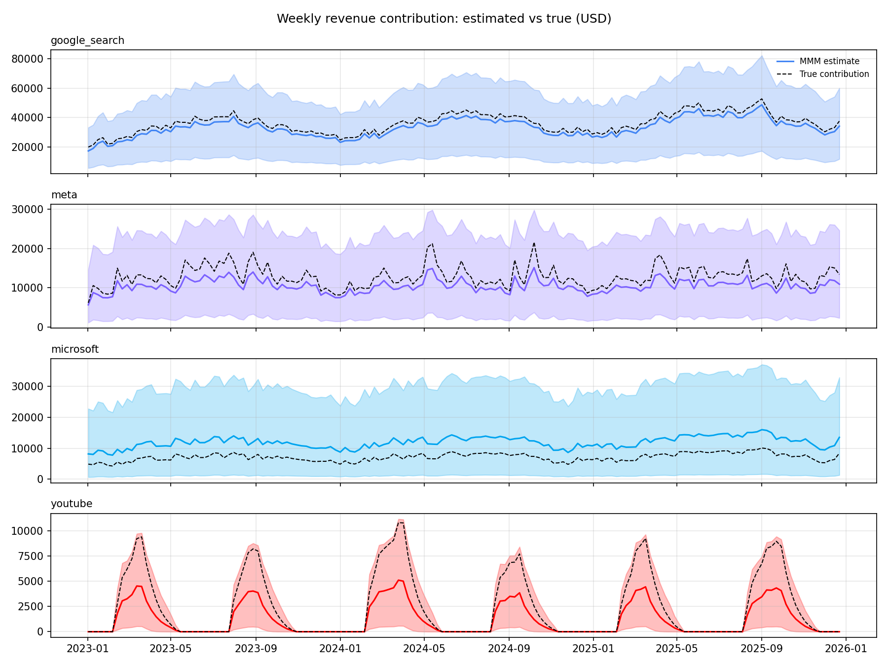
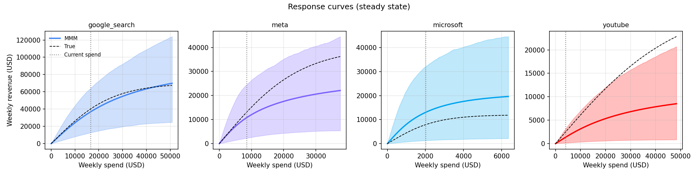
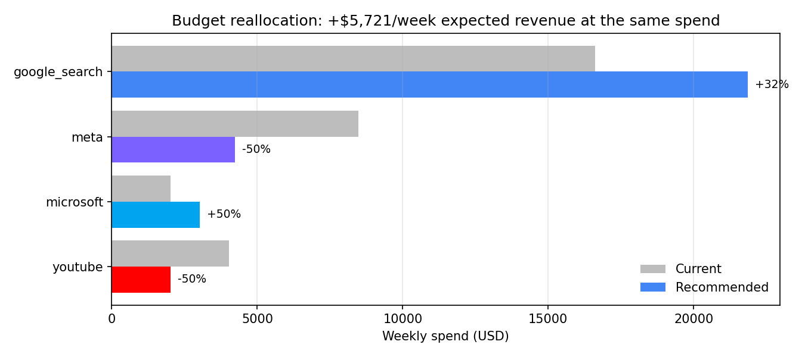
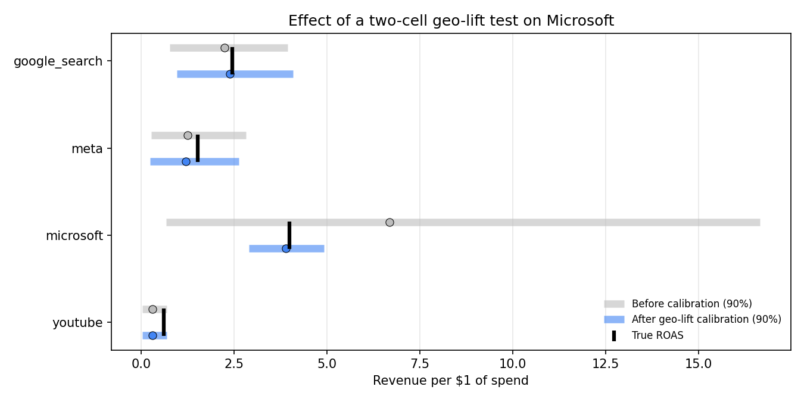

# Marketing Mix Model: what actually drove revenue?

A Bayesian Marketing Mix Model (MMM) built with [PyMC-Marketing](https://www.pymc-marketing.io/) that measures the **incremental** revenue from Google Search, Meta, Microsoft Ads and YouTube. It is calibrated with a geo-lift experiment and turned into a budget recommendation.

The data is simulated, so the **true** effect of every channel is known. That makes it possible to check how close the model gets, which real-world MMMs can never do.

> **Part 3 of a marketing analytics series**
> 1. [Multi-channel attribution & ROAS](https://github.com/paolofelix/multichannel-attribution-roas): which channel gets credit?
> 2. [Cohort LTV & CAC payback](https://github.com/paolofelix/cohort-ltv-cac-payback): what is a customer worth, and how fast does spend pay back?
> 3. **Marketing Mix Model**: what would have happened *without* each channel?

---

## Key results

| | |
|---|---|
| **Recommendation** | Same $31.1k weekly budget: Google **+32%**, Microsoft **+50%**, Meta **−50%**, YouTube **−50%** |
| **Expected uplift** | +$5.7k revenue per week; 92% probability it beats the current plan |
| **True uplift (ground truth)** | **+$3.0k per week (~$157k per year)**, which is 97% of the best achievable (+$3.1k) |
| **ROAS recovery** | True ROAS falls inside the model's 90% interval for all 4 channels |
| **Forecast accuracy** | 3.8% MAPE on 13 held-out weeks; all actuals inside the 90% interval |
| **Calibration** | One geo-lift test narrowed Microsoft's ROAS interval **8x** (16.0 → 2.0) and moved its estimate from 6.68 to 3.89 (true: 3.99) |


---

## The problem: simple regression gets it badly wrong

Regressing weekly revenue on weekly spend, the approach many teams start with, gives:

| Channel | True ROAS | Naive regression | Bayesian MMM (90% interval) |
|---|---|---|---|
| Google Search | 2.45 | 6.64 | 2.25 (0.77–3.95) |
| Meta | 1.52 | 1.69 | 1.25 (0.27–2.83) |
| Microsoft | 3.99 | **−6.06** | 6.68 (0.67–16.65) |
| YouTube | 0.61 | **0.02** | 0.31 (0.04–0.69) |

According to the naive model, Microsoft *destroys* revenue and YouTube does nothing. Both conclusions are wrong, and both would lead to bad budget decisions. The data was built with the three problems that cause this in real accounts:

- **Confounding:** Google spend rises and falls with seasonal demand, so a naive model credits Google for demand it didn't create.
- **Collinearity:** Microsoft campaigns copy Google's, so their spend is correlated at 0.88 (VIF 4.7).
- **Carryover:** YouTube runs in bursts, and its effect lasts weeks after a burst ends. Its correlation with same-week revenue is 0.02.



---

## Approach

| Step | What | Notebook |
|---|---|---|
| 1. Simulate | 156 weeks of spend and revenue with known adstock, saturation, seasonality, promos and a 10% price increase | `01_simulate_data.ipynb` |
| 2. Explore | Spend mix, correlation, VIF, naive regression | `02_eda.ipynb` |
| 3. Model | Bayesian MMM: geometric adstock → logistic saturation, controls, yearly Fourier seasonality | `03_model.ipynb` |
| 4. Validate | Ground-truth recovery and a 13-week out-of-sample forecast | `03_model.ipynb` |
| 5. Optimise | Response curves, marginal ROAS, constrained budget optimiser | `03_model.ipynb` |
| 6. Calibrate | Two-cell geo-lift test on Microsoft, added as a likelihood term | `03_model.ipynb` |

### Priors from domain knowledge

- **Effect size scaled by share of spend:** a channel with more spend is expected to drive more revenue. This helps separate Google from Microsoft.
- **Carryover by channel type:** search is short (people search when they're ready to buy), social is medium, and video is long.

This mattered. A first version gave every channel the same short-carryover prior. It estimated YouTube's carryover at 0.24 (true: 0.70) and understated its contribution.

### Model diagnostics

- 0 divergences, max r̂ 1.011, minimum ESS 743
- In-sample R² 0.92, MAPE 3.6%
- Prior predictive check covers the observed revenue range




The model attributes **30.7%** of revenue to media (true: 31.6%). It recovers the price increase at about −$31k per week (true: −$30k) and the promo weeks at about +$36k (true: +$35k).

---

## Validation against ground truth

**Carryover (adstock) recovered:**

| Channel | True | Estimated (90% interval) |
|---|---|---|
| Google Search | 0.20 | 0.25 (0.03–0.51) |
| Meta | 0.45 | 0.43 (0.14–0.74) |
| Microsoft | 0.20 | 0.25 (0.02–0.57) |
| YouTube | 0.70 | 0.61 (0.26–0.90) |

**Out-of-sample:** refit on the first 143 weeks and forecast the last 13 weeks. MAPE was 3.8%, and all 13 actual values fell inside the 90% interval.




---

## From model to decision

**Average ROAS** answers "how did this channel do?". **Marginal ROAS** answers "where should the next dollar go?". At current spend levels:

| Channel | Weekly spend | Avg ROAS | Marginal ROAS | True marginal |
|---|---|---|---|---|
| Google Search | $16.6k | 2.22 | 1.70 | 1.84 |
| Meta | $8.5k | 1.27 | 0.89 | 1.43 |
| Microsoft | $2.0k | 6.48 | 3.65 | 2.66 |
| YouTube | $4.0k | 0.34 | 0.33 | 0.62 |



The optimiser keeps the total budget fixed and limits each channel to between 50% and 150% of its current spend:



**Checking this against the truth:** the model expects +$5.7k per week, but the true gain is +$3.0k. The direction is right and the plan captures 97% of the best possible gain, but the size of the gain is overstated. That's because the optimiser leans hardest on the model's most uncertain estimate, Microsoft. Three of the four channels hit the ±50% guardrail, which is why guardrails and a staged rollout matter.

---

## Calibrating with a geo-lift experiment

A simulated two-cell geo test on Microsoft, run over 8 weeks:

| Cell | Design | Measured lift per week | Model predicted (before calibration) |
|---|---|---|---|
| Go dark | Microsoft turned off in test regions | −$7.9k (±$1.2k) | −$13.0k (−$32.1k to −$1.3k) |
| Double | Microsoft spend doubled in test regions | +$3.3k (±$0.5k) | +$4.6k (+$0.3k to +$12.2k) |

Both cells are needed. A single "double the spend" test only tells you the value of the *next* dollars, which left Microsoft's overall ROAS almost as uncertain as before. The go-dark cell pins down the value of the spend that's *already running*.

| Channel | True ROAS | Before | After calibration |
|---|---|---|---|
| Microsoft | 3.99 | 6.68 (interval width 16.0) | **3.89 (width 2.0)** |
| Google Search | 2.45 | 2.25 | **2.39** |

Google improves even though it wasn't tested, because the experiment settles how search credit is split between Google and Microsoft.



**What calibration did not fix:** the expected uplift is still $5.6k against $3.0k true. The remaining gap comes from Meta and YouTube, which weren't tested. The model undervalues both, so it underestimates what cutting them costs. **The next experiment should be on Meta or YouTube.**

---

## Limitations

- **Simulated data:** the real data-generating process is never this clean.
- **Steady-state optimisation:** YouTube runs in bursts, so a "−50%" recommendation in practice means fewer or shorter bursts.
- **No competitor activity, macro factors or channel interactions** are modelled. For example, YouTube could lift branded search.
- **The ±50% guardrails** are a business judgement, not a model output.

---

## How to run

All notebooks run in Google Colab and read the data directly from this repo.

```bash
pip install -r requirements.txt
```

Run the notebooks in order: `01` → `02` → `03`. Steps 3–6 run in one session in `03_model.ipynb`; the model fit takes about 1–3 minutes with the nutpie sampler.

`data/ground_truth/` is used **only** for validation. The model never reads it.

## Repository structure

```
├── data/
│   ├── mmm_data.csv              # model input
│   └── ground_truth/             # true contributions & parameters (validation only)
├── notebooks/
│   ├── 01_simulate_data.ipynb
│   ├── 02_eda.ipynb
│   └── 03_model.ipynb            # model, validation, optimisation, calibration
├── outputs/figures/              # all charts used in this README
├── src/simulate_data.py
└── requirements.txt
```

**Tech:** Python · PyMC-Marketing · PyMC · nutpie · ArviZ · pandas · NumPy · SciPy · Matplotlib
